# 《观澜》CORUI 测试套件 · 设计稿

> 状态：待确认（v0.1） · 需求：REQ-007 · 阶段：v1.6.0-stage-04
> 定位：开发期 UI 测试套件，不是玩家界面。用一套同风格的窗口，把 CORUI 的层级、栈、状态机、对象池、加载方式、传参和 C++ 控件逐个跑一遍。

---

## 1. 目标与边界

**目标**

1. 覆盖 CORUI 的可测试能力，每项能力都有可见的界面证据。
2. 十个窗口共用一套设计 token，风格统一、简约，可作为后续业务 UI 的视觉基线。
3. 每个窗口都是真实 UMG + TS Mixin，走框架原生工作流（PushUI / PopUI / UISingle / 生命周期）。
4. 提供一键自检：按脚本推入/弹出并输出 PASS/FAIL，便于回归。
5. 全流程可截图留档（PIE + MCP 截屏）。

**不做**

- 不做设置、背包、角色面板等业务 UI。
- 不改 CORUI 的 C++ 实现；只在 TS 侧登记本套件的推入/弹出计数。
- 不做本地化、音效、手柄/键盘全局快捷键（首期用按钮操作）。
- 不做像素级自适应，设计基准 1920×1080，窗口居中固定尺寸。

---

## 2. 视觉规范

### 2.1 色板

| Token | 值 | 用途 |
|---|---|---|
| `ink-0` | `#0A0908` | 全屏底色 |
| `ink-1` | `#12100E` (90%) | 窗口 / 卡片底 |
| `ink-2` | `#1A1714` | 分区、悬停底 |
| `paper` | `#EDE6DA` | 主文字、按钮描边 |
| `paper-2` | `#A9A093` | 次级文字、英文注脚 |
| `paper-3` | `#6E675D` | 日志、极弱提示 |
| `ember` | `#C8552F` | 唯一强调色：选中标记、确认、进度 |
| `gold` | `#B08A4F` | 极少量发丝线（可选） |
| `line` | `paper` 12% | 1px 分隔线 / 窗口描边 |
| `scrim` | `#000` 62% | 模态遮罩 |

规则：一屏只允许一处 ember 强调；不使用渐变、投影、圆角（≤2px）；不使用装饰花纹和图标，必要时用 8×8 ember 方块代替。

### 2.2 字体与字号

字体统一 **霞鹜文楷**（`Font_LXGWWenKai`，Regular）；文案使用普通术语，不使用修仙命名。

| 层级 | 字号 / 行高 | 用途 |
|---|---|---|
| Display | 40 / 56 | 窗口大标题（测试台、层级…） |
| H1 | 28 / 36 | 分区标题 |
| H2 | 20 / 30 | 条目标题、卡片标题 |
| Body | 16 / 26 | 正文、按钮 |
| Caption | 12 / 18 | 英文注脚、元信息 |
| Micro | 10 / 14 | 日志、ZOrder、实例号；英文全大写 + 2px 字距 |

### 2.3 间距与结构

- 8pt 栅格：4 / 8 / 16 / 24 / 32 / 48。
- 窗口内边距 32；分区间距 24；行高 56。
- 结构固定为「标题区 → 细线 → 内容区 → 细线 → 操作区」。
- 标题区左侧：大标题 + 极小英文副标题；右侧留白，不放按钮。

### 2.4 组件

- **文字按钮**：高 40，左右内边距 20，5px 描边（DPI 0.72 下约 3–4px，低分辨率可辨），直角；悬停描边转 `paper`，按下填充 12% `paper`，禁用整体 35%；危险/确认按钮描边 `ember`。
- **选中标记**：2×16 的 `ember` 竖条，贴左。
- **进度条**：2px 轨道，`ember` 填充，无圆角。
- **通知**：左侧 2px `ember` 竖条 + `ink-1` 底，标题 Body、正文 Caption，出现 180ms 淡入。
- **卡片**：`ink-1` 90% + 1px `line`；标题 H2；正文 Caption/paper-2。

### 2.5 动效

只做两种：窗口出现 160ms 淡入 + 8px 上移；通知从右侧 12px 滑入。其余状态切换不做动画，避免测试时干扰时序判断。

---

## 3. 窗口总览

| # | 窗口 | 资产 | 层级 / ZOrder | 尺寸 | 职责 |
|---|---|---|---|---|---|
| 01 | 测试台 | `UI_TestHub` | Normal / 200 | 1120×640 | 主台：导航、五层实时计数、事件流、一键自检 |
| 02 | 层级 | `UI_TestLayer` | Normal / 200 | 960×560 | 五层与 ZOrder；把其它窗口按层推入 / 收起 |
| 03 | 窗口栈 | `UI_TestStack` | Normal / 200 | 960×560 | 栈：推入、重名重推、弹顶、只弹上方、全部弹出、覆层 |
| 04 | 卡片 | `UI_TestCard` | Normal / 200 | 380×232 | 可复用信息卡：栈页；数据的接收窗口 |
| 05 | 数据 | `UI_TestData` | Normal / 200 | 960×560 | UISingle 传参、实例复用、生命周期计数、同步/异步 |
| 06 | 控件 | `UI_TestWidgets` | Normal / 200 | 960×560 | CORButton / CORImage / CORTextBlock / CORProgressBar |
| 07 | 调试 | `UI_TestDebug` | Debug / 500 | 全屏 overlay | 实时层级计数、事件日志、FPS/帧时间 |
| 08 | 确认 | `UI_TestConfirm` | Top / 300（FullScreen） | 560×280 + 遮罩 | 模态确认；也作为「覆层」测试的子窗口 |
| 09 | 通知 | `UI_TestToast` | Message / 400 | 360×88 | 消息层通知，3.2s 自动收起，无关闭按钮 |
| 10 | 背景 | `UI_TestBackdrop` | BackGround / 100 | 全屏 | 背景层示例：全屏压暗 + 角标 |

> 资产目录：`Content/UI/TestSuite/`；TS：`TypeScript/Game/UI/Test/`。
> 实际资产名：Hub=`UI_TestHubMain`、Layer=`UI_TestLayer2`、Card=`UI_TestCard2`（早期编辑器残留包占用了无后缀名），其余与表中一致；窗口名仍为 `UI_TestHub` / `UI_TestLayer` / `UI_TestCard`。

---

## 4. 界面说明

### 01 测试台 · Hub

布局：居中 1120×640 卡片。左列 240 宽为五项导航（层级 / 窗口栈 / 数据 / 控件 / 调试），每项上行中文 H2、下行英文 Caption，项间发丝线；当前项左侧 ember 竖条。右列为「层级 LAYERS」五行只读计数（背景/常规/顶层/消息/调试 + ZOrder + 数量）与「事件 EVENTS」最近三条日志；底部右侧「自检 RUN」「关闭全部」「收起」。

交互：导航 Push 对应窗口；自检运行动画/延时脚本；关闭全部按层逆序清空。

覆盖：Normal 层 Push、WindowName、CloseUI、自检入口、事件总线。

### 02 层级 · Layers

布局：标题 + 说明；五行列表，每行：层名（中文 + 英文）、ZOrder、当前数量、右侧「推入 / 收起」按钮。

行为：

- 背景 100 → 推入「背景」；常规 200 → 推入「窗口栈」；顶层 300 → 推入「确认」；消息 400 → 推入「通知」；调试 500 → 显示「调试」。
- 每层只维护一个示例实例，重复点击视为重推。
- 底部「全部收起」逆序清空五层。

覆盖：`EUILayerType` 五层、ZOrder（100/200/300/400/500）、层级内 Push/Pop、PushLayer 覆盖 CDO 层。

### 03 窗口栈 · Stack

布局：左侧五张错位叠放的「卡片」卡片（最多 5 张，序号 01–05，最上张完整显示），右侧一列操作：推入卡片 / 重名再推 / 弹出顶部 / 弹出其下 / 全部弹出 / 覆层测试；底部三行事件日志。

行为：

- 推入：以 `叶_01…05` 的 WindowName 依次推入，超过 5 张后不再推，日志提示。
- 重名再推：对最上张的 WindowName 再 Push 一次，验证同名窗口先被弹出再回到栈顶。
- 弹出顶部：`PopUI(NAME_None)`，验证默认弹栈顶。
- 弹出其下：对栈底窗口 `PopUI(name, Normal, false)`，验证只弹上方、保留自身。
- 覆层测试：把「确认」以 Normal 层推入（层级覆盖），其 `UnderWindowHide=true` 应让下方卡片进入 HiddenUnder；关闭后恢复，日志记录 OnHide/OnShow/OnCover。
- 全部弹出：逐个弹出直到空。

覆盖：栈顺序、同名重推、bPopSelf 语义、对象池实例复用、窗口状态机（HiddenUnder/Covered）、OnCover/OnHide/OnShow。

### 04 卡片 · Card

布局：380×232 卡片。标题「卡片」+ 序号（如 03）；正文两行说明；底部「关闭」「重名」两个小按钮；右上角极小字显示实例号与 Construct 次数。

作为数据的接收窗口时，标题/正文/序号来自 UISingle。

覆盖：同一 WBP 多实例、WindowName 命名、生命周期计数可视化。

### 05 数据 · Data

布局：左侧四行只读参数（名称 / 序号 / 语调 / 方式），下方「同步推入」「异步推入」；右侧「生命周期」四行计数（Construct / OnOpen / OnClose / Destruct）与「实例复用」（复用 是/否、实例号）；底部两行事件。

行为：两种方式各推一张「卡片」并传入 UISingle；手动修改名称/序号/语调；重复推入观察池复用与 Construct 不增长、OnOpen 增长。

覆盖：UISingle 传参、OnScriptInit、同步 vs 异步 `bIsAsync`、对象池复用、生命周期顺序。

### 06 控件 · Widgets

布局：2×2 四区，细线分隔：

- 按钮：常态 / 悬停 / 按下 / 禁用四个 CORButton，点击计数。
- 图像：CORImage 异步加载（先显示占位，`SetImagePath(path, matchSize)` 完成后替换），标注「异步 / matchSize」。
- 文本：三档字号（Display/Body/Caption）与两档颜色。
- 进度：CORProgressBar 0→100% 循环，右侧百分比，底部「重播」。

覆盖：四个 C++ 控件类、异步图片加载、matchSize、按钮状态视觉。

### 07 调试 · Debug

布局：全屏透明 overlay，左上 360 宽面板：FPS / 帧时间；五层计数；最近八条事件；底部「清空」「收起」。不阻挡其它窗口操作（面板本身只占据左上角区域）。

行为：由测试台或层级显示/收起；每 0.25s 刷新一次计数与事件。

覆盖：Debug 层、常驻 overlay、事件总线、运行时统计。

### 08 确认 · Confirm

布局：全屏遮罩 + 居中 560×280 卡片。标题「确认 / CONFIRM」，正文来自 UISingle，右下「取消」「确认」。确认结果写日志并关闭。

继承 `UCORFullScreen`，`UnderWindowHide=true`。作为模态时在 Top 层；作为覆层测试时以 Normal 层推入。

覆盖：FullScreen、遮罩、Top 层、状态遮盖、UISingle。

### 09 通知 · Toast

布局：360×88，右上角纵向堆叠（间距 8，最多 3 条）。左侧 2px ember 竖条；标题 Body、正文 Caption。无关闭按钮，3.2s 后自动关闭；同一 WindowName 重推时重置计时。

覆盖：Message 层、自动关闭、堆叠排布、重复推入。

### 10 背景 · Backdrop

布局：全屏 `ink-0` 55% 压暗 + 左下角极小角标「背景 · 背景层 100」。无交互。

覆盖：BackGround 层真实位于最底层，不遮挡任何 UI。

---

## 5. 测试矩阵

| CORUI 能力 | 窗口 | 可观察证据 |
|---|---|---|
| 五层容器与 ZOrder | 层级、测试台、调试 | 五层计数、推入后位置 |
| 同层栈 Push/Pop | 窗口栈、卡片 | 卡片序号、栈深度日志 |
| 同名窗口重推 | 窗口栈、通知 | 旧实例 OnClose → 新 OnOpen，数量不变 |
| `bPopSelf=false` 只弹上方 | 窗口栈 | 栈底保留、上方移除 |
| FullScreen 弹栈 | 确认、窗口栈 | 关闭时连同上方窗口一起收起 |
| 窗口状态机 / UnderWindowHide | 窗口栈（覆层）、确认 | OnHide/OnShow/OnCover 日志 |
| 对象池复用 | 数据、卡片 | 实例号不变、Construct 不增长、OnOpen 增长 |
| 同步 / 异步加载 | 数据 | 回调顺序、日志中的 async 标记 |
| UISingle 传参 | 数据、卡片、确认、通知 | 标题/正文与传入一致 |
| CORButton / CORImage / CORTextBlock / CORProgressBar | 控件 | 按钮状态、图片异步替换、进度动画 |
| Message 层自动收起 | 通知 | 3.2s 后计数归零 |
| Debug 层常驻覆盖 | 调试 | 覆盖在最上层、随其它窗口变化刷新 |
| 生命周期钩子 | 全部 | Construct/OnOpen/OnShow/OnHide/OnClose/Destruct 计数 |

---

## 6. 导航与入口

```
GameLoading 完成
   └─(dev switch, 400ms)─→ 测试台 Hub
                              ├─ 层级 → 推入 背景/窗口栈/确认/通知/调试
                              ├─ 窗口栈 → 推入 卡片×N；覆层 → 确认(Normal)
                              ├─ 数据 → 推入 卡片（同步/异步，带 UISingle）
                              ├─ 控件 → 本地控件演示
                              └─ 调试 → Debug overlay
```

- 入口开关：`TestUIManager.Enabled`（TS 常量，默认 `true`，仅开发期）。关闭时加载完成不弹 Hub。
- 巡游开关：`TestUIManager.AutoDemo`（默认 `false`）。置 `true` 时 Hub 打开后每 3 秒巡游一个实验室，仅供自动截图验证。
- 每个实验室左上或右下都有「返回」，关闭自身；「关闭全部」位于测试台与层级。
- 首期无全局快捷键；F1/F2 作为后续可选项。

---

## 7. 自检脚本

测试台「自检」按固定时序执行（9 步，每步间隔 400–600ms，异常即 FAIL）：

1. 推入卡片 `卡片_A` → 期望卡片计数 +1，Construct/OnOpen 触发。
2. 以同名 `卡片_A` 重推 → 期望卡片计数不变，出现 OnClose → OnOpen。
3. `PopUI(NAME_None)` → 期望卡片计数 −1，OnClose 触发。
4. 推入卡片 `卡片_B`、`卡片_C` → 期望卡片计数 2。
5. 按名弹出 `卡片_C` → 期望 `卡片_B` 保留、`卡片_C` 移除。
6. 以 Normal 层推入确认（UnderWindowHide）→ 期望 `卡片_B` 记录 OnHide。
7. 关闭确认 → 期望 `卡片_B` 记录 OnShow。
8. 异步推入卡片 `卡片_D` → 期望回调成功、实例入栈。
9. 逐层清空（保留 Hub）→ 期望卡片计数 0。

指定：每条 `[TestSelfCheck] PASS/FAIL 步骤名` 同时写入控制台与测试台事件流；测试台左下显示 `自检通过 9/9`，调试保留最近事件。

> PIE 实测：2026-11-04，9/9 PASS；日志见 `docs/design/screenshots/hub.png` 的底部提示。

---

## 8. 工程结构

```
Content/UI/TestSuite/
  UI_TestHubMain.uasset / UI_TestLayer2 / UI_TestStack / UI_TestCard2 /
  UI_TestData / UI_TestWidgets / UI_TestDebug / UI_TestConfirm /
  UI_TestToast / UI_TestBackdrop

TypeScript/Game/UI/Test/
  UI_TestHub.ts …（每个窗口一个 Mixin）
  UI_TestSingleType.ts        // UISingle 键位映射
  TestPaths.ts                // 资产路径、窗口名、层级表
TypeScript/Manager/TestUIManager.ts   // 单例：打开/关闭/计数/事件/自检
```

- 所有窗口继承 `UCORWindow`，确认继承 `UCORFullScreen`。
- 视觉参数（颜色、字体、间距）以 WBP 默认值为准；TS 只改动态文本、计数、显隐。
- 现有文件只改一处：`UI_GameLoading.ts` 增加完成回调（受 `Enabled` 开关保护）；`TestUIManager` 为惰性单例，无需在 `GameManager` 初始化。

---

## 9. 实施计划

1. **技术验证（半天）**：用 MCP 建一个空白 `UI_TestCard`，验证创建/加控件/设属性/设字体/编译/保存链路；确认 `tsc` 可编。
2. **资产搭建**：按 04 → 09 → 10 → 08 → 02 → 03 → 05 → 06 → 07 → 01 的顺序建十个 WBP（先基础再组合）。
3. **TS Mixin**：十个窗口的骨架 + `TestUIManager` / 事件总线 / 单类型。
4. **接线**：加载完成入口、导航、自检脚本。
5. **验证**：`tsc` 通过；PIE 启动；逐窗口截图；运行自检确认 8/8；检查日志无 CORUI Error。
6. **收尾**：把截图与验证记录写入阶段目录，提交。

---

## 10. 风险与对策

| 风险 | 对策 |
|---|---|
| UMG 资产只能由编辑器/MCP 生成，属性设置易静默失败 | 先做单窗口技术验证；属性名先用 `list_properties` 确认；失败项改由 TS 运行时设置 |
| 字体/颜色在 WBP 默认值中设置失败 | 文本样式在 TS `OnScriptInit` 统一刷新（`SetFont`/`SetColorAndOpacity`） |
| 池复用导致 Construct 次数与预期不符 | 计数以 OnOpen/OnClose 为主，Construct 作为参考并在界面注明 |
| 异步加载回调时序不稳定 | 日志带时间戳；自检等待固定延时，失败时输出实际序列 |
| 非 16:9 分辨率 | 卡片固定尺寸 + 居中锚点；不追求布局自适应 |
| MCP 操作大量资产耗时 | 每个 WBP 用一段批处理脚本一次性构建；失败可重跑单窗口 |

---

## 11. 待确认

1. 十个窗口的清单是否保留？是否需要增删某一屏（例如合并「数据」到「窗口栈」）。
2. 命名与文案（测试台 / 层级 / 窗口栈 / 卡片 / 数据 / 控件 / 调试 / 确认 / 通知 / 背景）是否合意。
3. 入口是否接受「加载完成后自动弹出测试台」（开发期开关）。
4. 视觉上是否维持「深墨 + 暖白 + 锈红、无圆角无阴影」；是否需要更亮/更轻的纸感版本。

---

## 12. 验证记录（2026-11-04）

| 项目 | 结果 |
|---|---|
| TS 编译 | `tsc -p tsconfig.json` 退出码 0，无错误 |
| WBP 资产 | 10 个，全部编译并保存（`Content/UI/TestSuite/`） |
| PIE 视口 | 2038×782，DPI 0.7235（编辑器内嵌视口） |
| 逐窗验证 | 测试台 / 层级 / 窗口栈 / 数据 / 控件 / 调试 / 确认 / 通知 / 背景 均可正常打开与关闭 |
| 层级计数 | 按层统计正确（如 Hub 打开后 Normal=1；层级推入后 Normal=2） |
| 自检 | 9/9 PASS（日志 `[TestSelfCheck] PASS …`） |
| 本轮调整 | 文案改为普通术语；字体恢复霞鹜文楷；按钮描边由 1 加粗到 5（DPI 0.72 下约 3–4px） |
| 已知限制 | 文字阴影来自字体资源本身 |

## 12.1 复验记录（2026-11-07，CORUI F1–F14 修复后）

| 项目 | 结果 |
|---|---|
| 触发方式 | `TestUIManager.AutoDemo = true` 后 PIE：观澜台自动巡游全部窗口，第 24 秒自动跑 9 步自检 |
| 自检 | **9/9 PASS**（推入一叶 / 同名重推 / 弹出顶部 / 叠两张 / 按名弹出 / 覆层隐藏 / 覆层恢复 / 异步推入 / 清空），日志 `[TestSelfCheck] PASS …` |
| 生命周期 | AutoDemo 期间各窗口 Push/Open/Close 计数配对，层内计数随关闭回落，无 CORUI Error / 异常 |
| 截图 | 全部按新描边（3px）重拍；`debug.png` 同时使用 F14 新标签（`FPS · 帧 · 刷新`） |
| 说明 | 复验后 `AutoDemo` 已恢复默认 `false`；如需再次自动巡游，临时置 `true` 并 `tsc` 即可 |

## 12.2 描边折中与 Toast 队列（2026-11-07）

| 项目 | 结果 |
|---|---|
| 按钮描边 | `Tools/UIBuilder/ui_builder.py` 的 `BUTTON_BORDER` 由 5 改为 **2**（1 在低分辨率看不清，5 偏粗），10 个窗口资产已按 2px 重建、编译并保存 |
| 消息层 Toast | 改为 **3 槽位 + 队列**：槽位 0/1/2 依次下移 120 UMG 像素，满槽后排队，任一条收起后下一条补位 |
| 队列验证 | AutoDemo 一次推 4 条：日志 `slot=0/1/2` + `queued (pending=1)`；首条关闭后 `UI_TestToast_4 slot=0` 补位；3 条同屏截图见 `screenshots/toast.png` |
| 回归 | 同一轮 AutoDemo 自检仍 **9/9 PASS** |
| 参数位置 | 槽位数/间距在 `TestUIManager.ToastSlotCount` / `ToastSlotHeight`，描边宽度在 `BUTTON_BORDER` |

> 说明：描边与 Toast 均为表现层改动；自检 9/9 已在 12.1、12.2 两轮复验中确认。
> 所有截图（含 `toast.png`）均按 2px 描边重拍。

## 12.3 TypeScript 声明生成（2026-11-07）

`Typing/**/*.d.ts` 是生成物，不再手工编辑。生成入口是 Puerts 的编辑器控制台命令 `Puerts.Gen`
（DeclarationGenerator 模块），封装为脚本：

```powershell
# 先关闭正在使用的 UE 编辑器（项目锁）
pwsh Tools/TypeScript/gen-typings.ps1
```

- 实现：`UnrealEditor-Cmd.exe <uproject> -ExecutePythonScript="Tools/TypeScript/gen_typings.py" -unattended -nosplash -nopause`
  由 Python 在 Slate tick 回调里执行 `Puerts.Gen` 再 `Quit`（`-ExecCmds` 阶段该命令尚未注册，不能用）。
- 脚本会校验 `Typing/ue/ue.d.ts` 时间戳已更新，并可选跑 `tsc` 校验。
- 已实测：生成后 `ue.d.ts` 约 15.3 MB，包含 `IsUIInitialized` / `ReleaseHandle` / `CancelHandle` / `ReleaseAll`；
  `tsc -p tsconfig.json` 通过。
- 新增的 JS 可见方法必须是 `UFUNCTION` 才能进入生成物；非 UFUNCTION 的 `DefineClass.Method` 绑定不会出现在 `ue.d.ts`。


> 说明：文案/字体/描边调整不涉及逻辑；自检 9/9 沿用上一轮结果，逐窗截图已按新文案重拍。

验证截图：

| 界面 | 截图 |
|---|---|
| 测试台 | 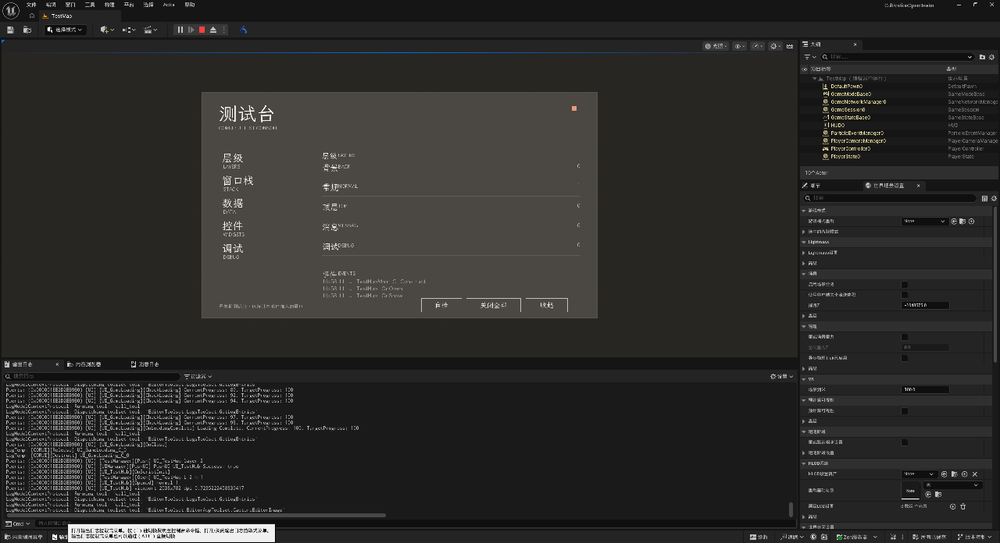 |
| 层级 | 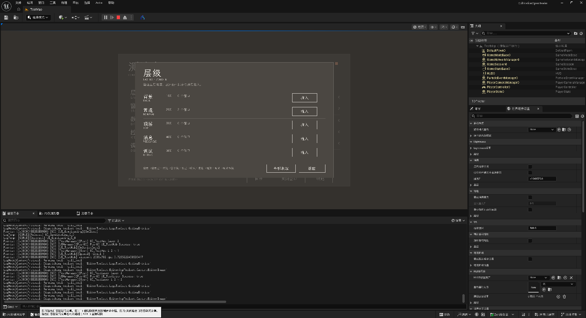 |
| 数据 |  |
| 控件 |  |
| 调试 | 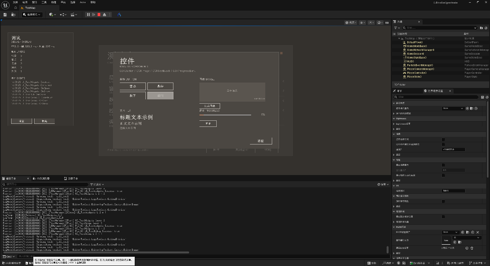 |
| 确认 + 通知 |  |
| 通知队列（3 槽位） | 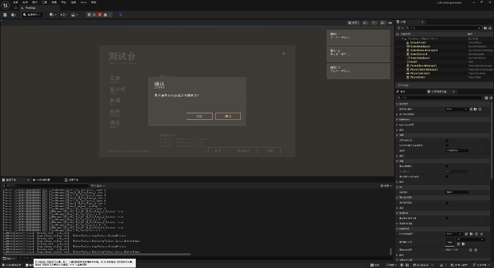 |

---

## 附：概念图

| 界面 | 图 |
|---|---|
| 测试台 | 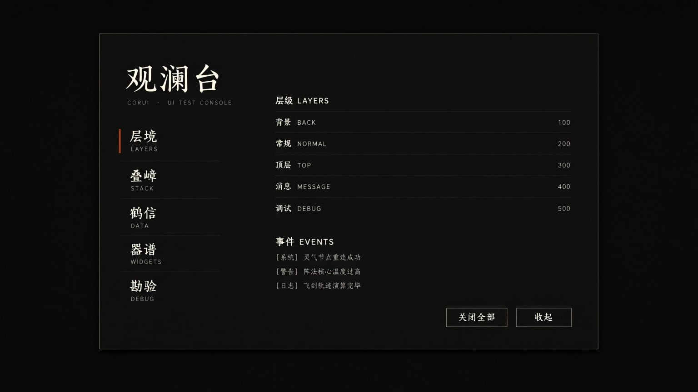 |
| 层级 | 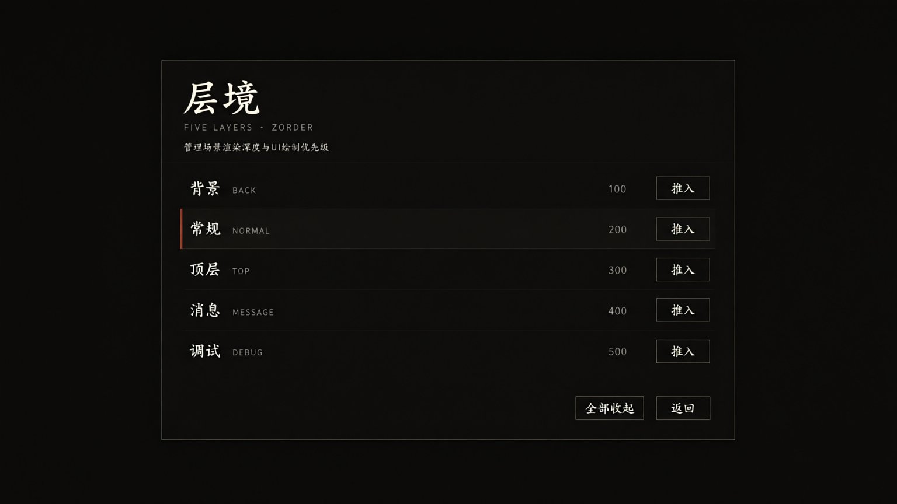 |
| 窗口栈 | 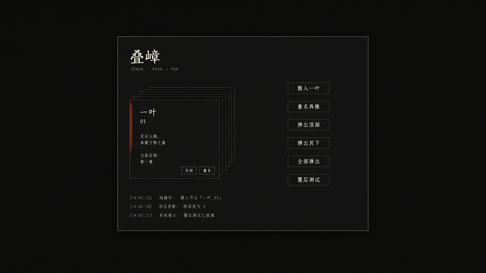 |
| 数据 | 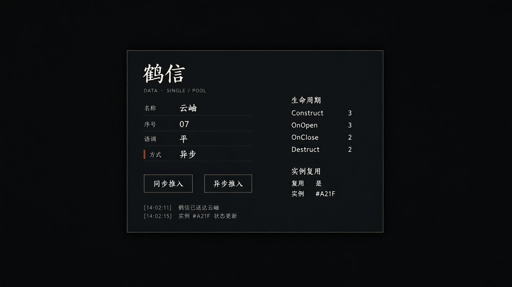 |
| 控件 | 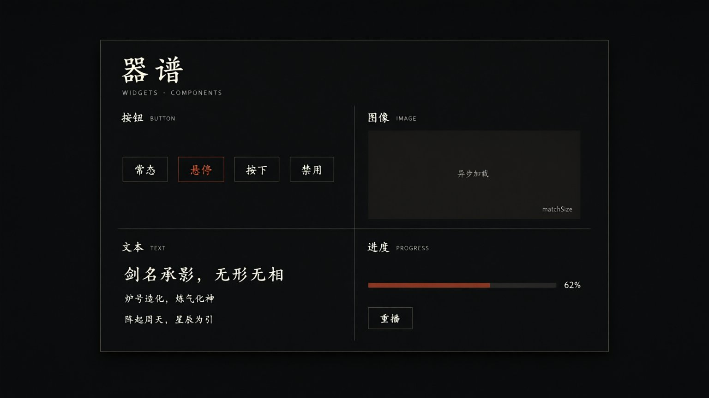 |
| 调试 | 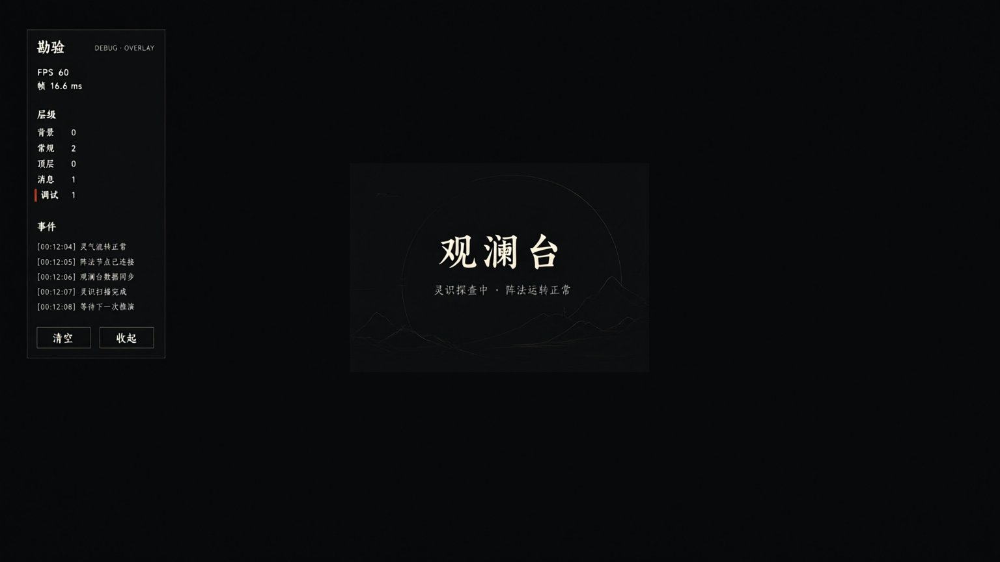 |
| 确认 | 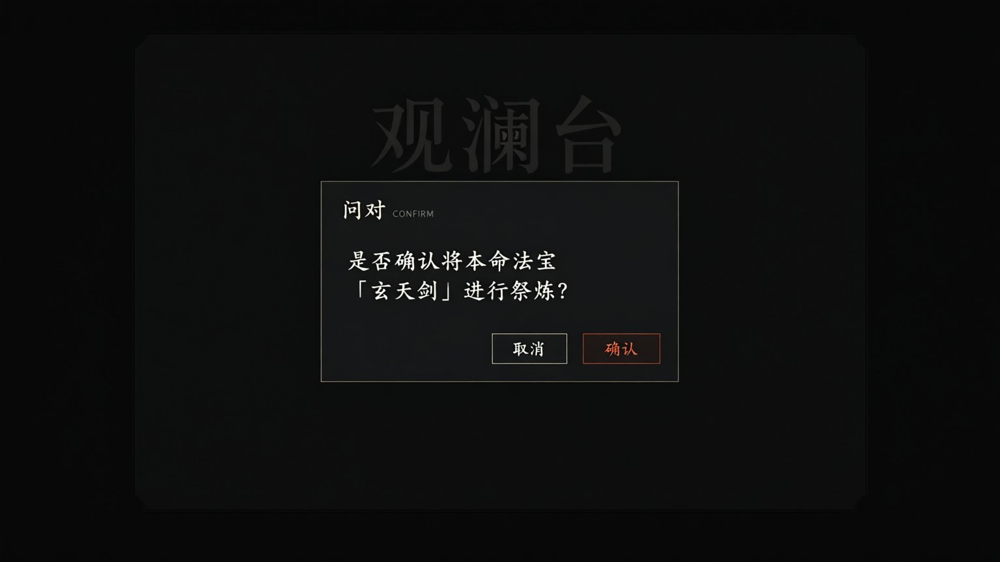 |
| 通知 | 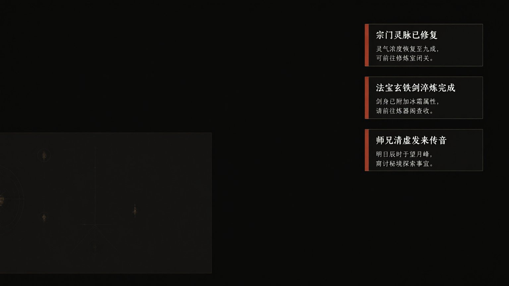 |

> 概念图由 `qwen-image-3.0` 生成，用于确定风格与布局；概念图早于本轮文案调整，其中的修仙命名仅作风格参考，最终以本文与实机截图为准。
